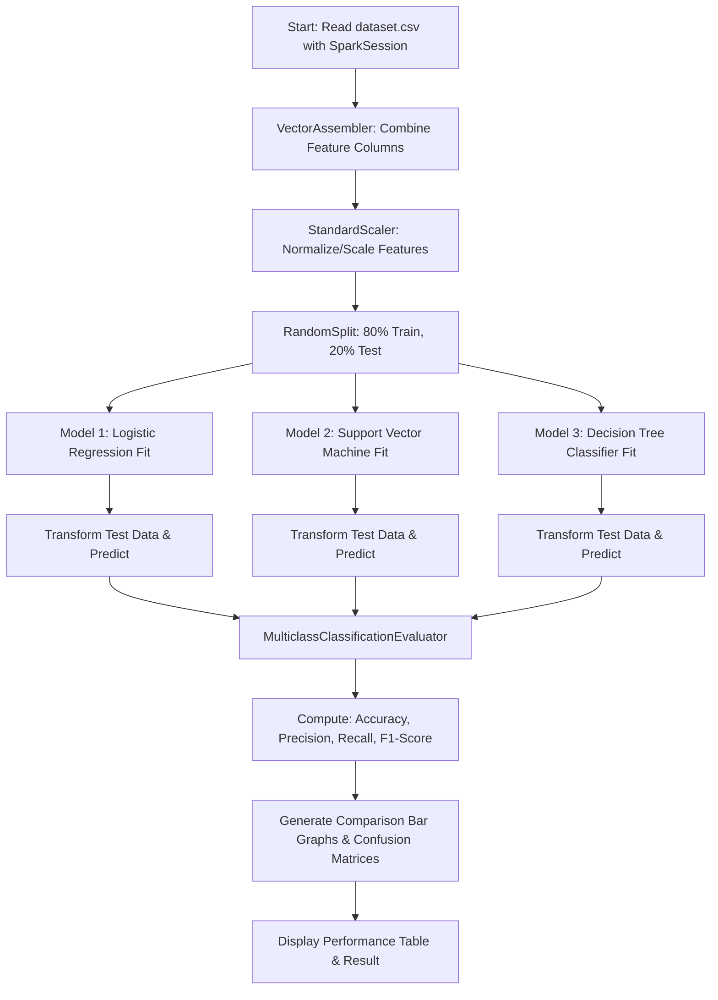

# Exercise No 11 : Classification using PySpark (Logistic Regression, SVM, Decision Tree)

## Aim
To perform classification using **Logistic Regression**, **Support Vector Machine (LinearSVC)**, and **Decision Tree Classifier** algorithms in **PySpark MLlib**, visualize the results using comparison graphs, and compare the accuracy and performance of the algorithms using **Precision**, **Recall**, and **F1-Measure**.

---

## Prerequisites & Tools Used
- **Language**: Python 3.12+
- **Framework**: Apache PySpark 3.x / 4.x (`pyspark.ml`)
- **Java Runtime**: OpenJDK 17
- **Data & Visualization Libraries**: NumPy, Pandas, Matplotlib, Seaborn, Scikit-learn

---

## Machine Learning Algorithms Overview

### 1. Logistic Regression
- **Concept**: A supervised statistical model that estimates the probability of a binary response using a sigmoid (logistic) activation function.
- **Mathematical Form**:
  $$\sigma(z) = \frac{1}{1 + e^{-z}} \quad \text{where } z = w^T x + b$$
- **Loss Function**: Binary Cross-Entropy (Log-Loss) with $L_2$ regularization.

### 2. Support Vector Machine (LinearSVC)
- **Concept**: A maximum-margin classifier that constructs an optimal separating hyperplane maximizing the geometric distance between two classes.
- **Mathematical Form**:
  $$\min_{w, b, \xi} \frac{1}{2} \|w\|^2 + C \sum_{i=1}^n \xi_i \quad \text{subject to } y_i (w^T x_i + b) \ge 1 - \xi_i, \quad \xi_i \ge 0$$
- **Loss Function**: Hinge loss with regularization parameter $C$.

### 3. Decision Tree Classifier
- **Concept**: A non-parametric supervised learning algorithm that partitions the feature space recursively using decision rules at internal nodes.
- **Splitting Criterion**: Gini Impurity or Information Gain (Entropy):
  $$\text{Gini}(D) = 1 - \sum_{i=1}^k p_i^2$$

---

## Evaluation Metrics

1. **Accuracy**:
   $$\text{Accuracy} = \frac{TP + TN}{TP + TN + FP + FN}$$
2. **Precision**:
   $$\text{Precision} = \frac{TP}{TP + FP}$$
3. **Recall (Sensitivity)**:
   $$\text{Recall} = \frac{TP}{TP + FN}$$
4. **F1-Measure (Harmonic Mean of Precision and Recall)**:
   $$\text{F1-Measure} = 2 \times \frac{\text{Precision} \times \text{Recall}}{\text{Precision} + \text{Recall}}$$

---

## Algorithm Steps / Execution Flow



---

## How to Run

1. **Run the standalone script**:
   ```bash
   ./.venv/bin/python ex11_classification.py
   ```

2. **Generated Output Artifacts**:
   - `classification_comparison.png`: Grouped bar chart comparing Accuracy, Precision, Recall, and F1-Score.
   - `confusion_matrices.png`: 3-panel confusion matrix heatmap for all models.

---

## Result
Logistic Regression, Support Vector Machine (LinearSVC), and Decision Tree classifiers were successfully implemented and trained using PySpark MLlib. The classification metrics (Accuracy, Precision, Recall, and F1-Measure) were evaluated and plotted graphically for comprehensive model comparison.
