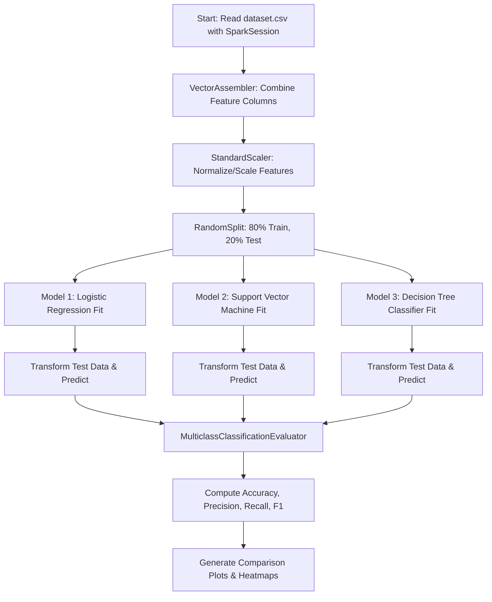

# Big Data Analytics (BDA) Environment & Lab Exercises

A complete, self-contained, reproducible Big Data Analytics (BDA) environment running **Apache Hadoop (HDFS & YARN)**, **Apache Hive**, **Apache Pig**, **Apache HBase**, and **PySpark MLlib**.

Designed for one-click setup on local machines, lab computers, and examination devices across **Linux**, **macOS** (Intel & Apple Silicon), and **Windows (WSL2)** with zero host configuration needed beyond Docker.

---

## 🚀 One-Click Quickstart

Clone the repository and run the installer:

```bash
git clone https://github.com/Ghua8088/bda.git
cd bda
./install.sh
```

### What `install.sh` Does Automatically:
1. Verifies Docker & Docker Compose installation.
2. Creates global CLI wrappers in `~/.local/bin/` (`hadoop`, `hdfs`, `hive`, `pig`, `hbase`, `bda-status`, etc.).
3. Adds `~/.local/bin` to your `PATH` in `~/.bashrc`, `~/.zshrc`, and `~/.profile`.
4. Starts the containerized BDA cluster in the background.
5. Waits until HDFS safely exits safe mode and verifies cluster health.

> [!TIP]
> After running `./install.sh`, reload your shell environment with `source ~/.bashrc` (or open a new terminal window).

---

## 🛠️ CLI Tools & Everyday Commands

Run these commands directly from **any directory** in your terminal:

| Tool | Command Example | Description |
| :--- | :--- | :--- |
| **Hadoop** | `hadoop version` | Display Hadoop distribution & version |
| **HDFS** | `hdfs dfs -ls /`<br>`hdfs dfs -put dataset.csv /data/`<br>`hdfs dfs -cat /data/part-00000` | Full HDFS file management |
| **Apache Pig** | `pig -x local docker-bda/samples/sample_pig.pig`<br>`pig -x local` | Run Pig Latin scripts or enter interactive Grunt shell |
| **Apache Hive** | `hive -e "SHOW DATABASES;"`<br>`hive -f docker-bda/samples/sample_hive.sql`<br>`hive` | Run inline HiveQL, SQL script, or enter Hive shell |
| **Apache HBase** | `hbase` | Open interactive HBase NoSQL shell |
| **Cluster Management** | `bda-status`<br>`bda-stop`<br>`bda-start` | Check daemon status (`jps`), stop, or start cluster |
| **Shell Access** | `enter-hadoop`<br>`enter-hbase` | Open interactive bash terminal inside containers |

---

## 🌐 Web Dashboards

All web dashboards are exposed directly on `localhost`:

| Service | Web Interface URL | Notes |
| :--- | :--- | :--- |
| **HDFS NameNode UI** | [http://localhost:50070](http://localhost:50070) | Browse HDFS filesystem, datanode health |
| **YARN ResourceManager UI** | [http://localhost:8088](http://localhost:8088) | Monitor MapReduce and Spark jobs |
| **HBase Master UI** | [http://localhost:16010](http://localhost:16010) | Inspect HBase tables and region servers |
| **JobHistory Server** | [http://localhost:19888](http://localhost:19888) | Historical job metrics |

---

## 🧪 Laboratory Exercises

### Exercise 1: Word Count using Hadoop Streaming (MapReduce)
Located in [`ex_1/`](file:///home/ghua/bda/ex_1):
- Uses Python mapper ([`mapper1.py`](file:///home/ghua/bda/ex_1/mapper1.py)) and reducer ([`reducer1.py`](file:///home/ghua/bda/ex_1/reducer1.py)).
- Processes text input ([`sample.txt`](file:///home/ghua/bda/ex_1/sample.txt)) through YARN MapReduce.

**Run with one command:**
```bash
./ex_1/run.sh
```

**Or manually via Hadoop Streaming:**
```bash
# 1. Put input in HDFS
hdfs dfs -mkdir -p /ex_1/input
hdfs dfs -put -f ex_1/sample.txt /ex_1/input/

# 2. Run MapReduce Streaming Job
hadoop jar /usr/local/hadoop/share/hadoop/tools/lib/hadoop-streaming-2.9.2.jar \
  -input /ex_1/input/sample.txt \
  -output /ex_1/output \
  -mapper "python /workspace/ex_1/mapper1.py" \
  -reducer "python /workspace/ex_1/reducer1.py" \
  -file "/workspace/ex_1/mapper1.py" \
  -file "/workspace/ex_1/reducer1.py"

# 3. View HDFS results
hdfs dfs -cat /ex_1/output/part-00000 | head -n 25
```

---

### Exercise 11: Classification using PySpark (Logistic Regression, SVM, Decision Tree)
Located in [`ex11_classification.py`](file:///home/ghua/bda/ex11_classification.py) and [`Ex11_Classification_PySpark.ipynb`](file:///home/ghua/bda/Ex11_Classification_PySpark.ipynb):
- Evaluates classification performance on [`dataset.csv`](file:///home/ghua/bda/dataset.csv).
- Compares **Logistic Regression**, **Support Vector Machine (LinearSVC)**, and **Decision Tree Classifier** in PySpark MLlib.
- Evaluates **Accuracy**, **Precision**, **Recall**, and **F1-Measure**.
- Generates comparison charts (`classification_comparison.png` and `confusion_matrices.png`).



---

### Exercise 12: K-Means Clustering using PySpark
Located in [`Ex12_Kmeans_PySpark.ipynb`](file:///home/ghua/bda/Ex12_Kmeans_PySpark.ipynb):
- Unsupervised clustering with [`kmeans_dataset.csv`](file:///home/ghua/bda/kmeans_dataset.csv).
- Computes Within Set Sum of Squared Errors (WSSSE) and Silhouette score across cluster values $k$.

---

## 💻 Cross-Platform Setup & Requirements

### Prerequisites:
Only **Docker** is required on your host machine.

- **Ubuntu / Debian**:
  ```bash
  sudo apt update && sudo apt install -y docker.io docker-compose-v2
  sudo usermod -aG docker $USER && newgrp docker
  ```
- **macOS** (Intel & Apple Silicon M1/M2/M3/M4):
  Install [Docker Desktop for Mac](https://www.docker.com/products/docker-desktop/).
  *(Images run with `platform: linux/amd64` using automatic Rosetta 2 emulation).*
- **Windows**:
  Install [Docker Desktop for Windows](https://www.docker.com/products/docker-desktop/) with the **WSL2 backend enabled**. Open your Ubuntu WSL2 terminal and run `./install.sh`.

---

## 📁 Repository Structure

```text
bda/
├── install.sh                  # One-click installer & PATH config
├── .gitignore                  # Clean repository ignores
├── dataset.csv                 # Classification sample dataset
├── kmeans_dataset.csv          # Clustering sample dataset
├── ex_1/                       # Exercise 1: Hadoop Streaming MapReduce
│   ├── mapper1.py              # WordCount mapper
│   ├── reducer1.py             # WordCount reducer
│   ├── sample.txt              # Sample input text
│   └── run.sh                  # Automated Exercise 1 runner script
├── ex11_classification.py       # Exercise 11 Python script
├── Ex11_Classification_PySpark.ipynb # Exercise 11 Jupyter Notebook
├── Ex12_Kmeans_PySpark.ipynb   # Exercise 12 Jupyter Notebook
└── docker-bda/                 # Docker Compose infrastructure
    ├── docker-compose.yml      # Multi-container service definitions
    ├── bin/                    # Local launcher scripts
    │   ├── hadoop              # Hadoop wrapper
    │   ├── hdfs                # HDFS wrapper
    │   ├── hive                # Hive wrapper
    │   ├── pig                 # Pig wrapper
    │   ├── hbase               # HBase wrapper
    │   ├── enter-hadoop        # Hadoop container shell
    │   └── enter-hbase         # HBase container shell
    └── samples/                # Sample SQL, Pig, and HBase scripts
        ├── sample_pig.pig
        ├── sample_hive.sql
        └── sample_hbase.txt
```
